<div align="center">


# bluetardigrade

**A self-hosted SOC for Windows endpoints: detect, investigate and respond from one console.**

Rust ETW sensor · single-binary Go detection engine · live web console.<br/>
Named after the most resilient animal on Earth.

[](https://github.com/Ruby570bocadito/bluetardigrade/actions/workflows/ci.yml)
[](CHANGELOG.md)
[](LICENSE)
[](go.mod)
[](sensor/)
[](web/console/)
[](rules/)

[**Watch the demo**](#see-it-in-action) · [**Quickstart**](#quickstart) · [Features](#what-you-get) · [Console tour](#console-tour) · [Security](#security-model) · [Architecture](#architecture) · [Docs](#documentation) · [**Guía en español**](docs/GUIA-INICIO.md)

</div>

<p align="center">
  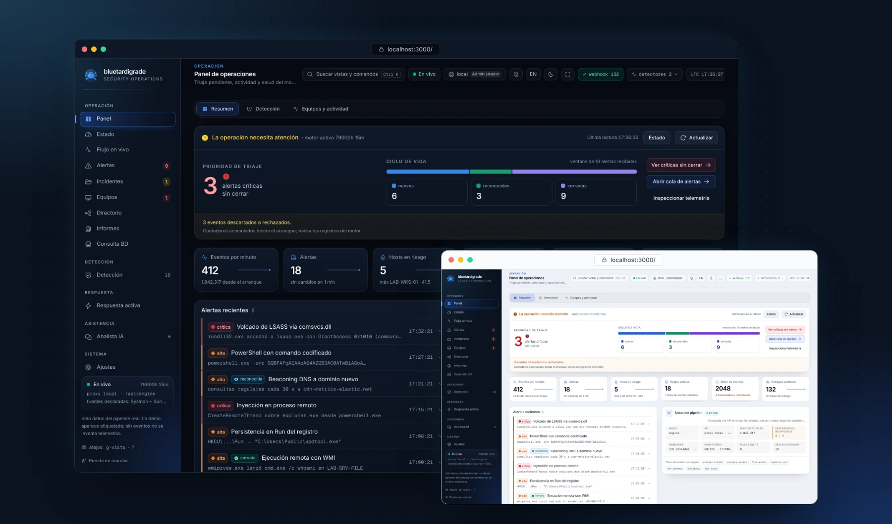
</p>

<p align="center">
  <a href="docs/assets/demo/bluetardigrade-demo.mp4"><b>▶&nbsp; Full tour in video (MP4, 1 min 40 s)</b></a>
</p>

A sensor on each Windows machine streams process, network, DNS, registry and
file telemetry to a **single static Go engine**. The engine matches it against
readable YAML rules mapped to **MITRE ATT&CK**, correlates kill chains, scores
host risk and freezes a forensic bundle for every alert. Analysts triage,
investigate and respond from a **live web console**, in Spanish or English,
dark or light.

> [!NOTE]
> **Pre-1.0 (`v1.0.0-rc1`): built for labs, research and small SOC teams.**
> Product builds contain no demo telemetry generator: an empty or disconnected
> console stays empty. The clips and screenshots below use the repository's
> contract-true fixtures (LAB-* hosts), and the console labels that window as
> demo data.

---

## See it in action

Every clip is a real run of the console, driven by a script you can replay
([`record_demo.mjs`](docs/assets/src/record_demo.mjs)). The interface shown is
the Spanish one; a toggle in the header switches it to English.

### 1 · Sign in

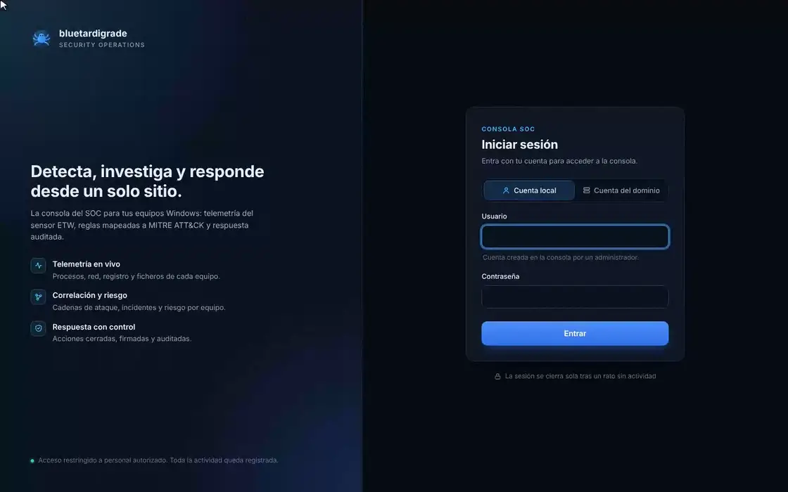

Local accounts with roles (viewer, analyst, administrator), **Active Directory
accounts** whose groups grant the role, optional or per-role **two-step
sign-in** (TOTP + recovery codes) and secure sessions. Every attempt lands in
the audit trail.

### 2 · Triage the alert queue

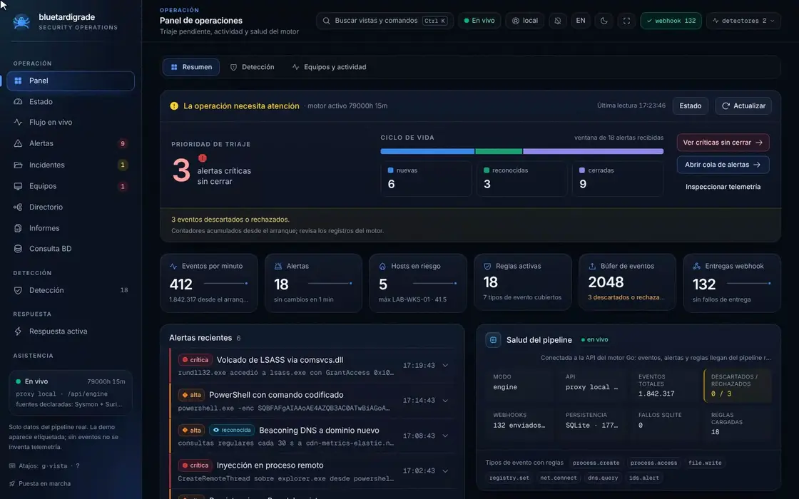

The panel says what needs attention now. The queue filters by severity,
lifecycle and owner; each alert opens its detail, entity graph and forensic
bundle; several alerts can be **acknowledged, closed, assigned, suppressed or
added to an incident** in one go.

### 3 · Work an incident

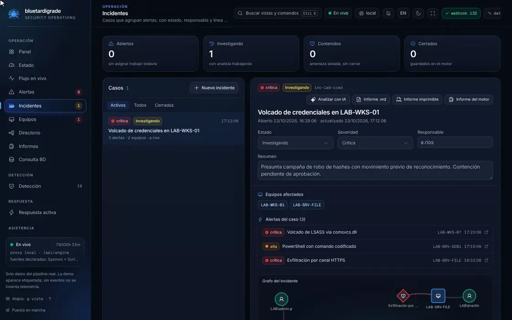

Incidents group alerts across machines, with status, severity, owner, summary,
an **incident graph** and a timeline of every change and note — exportable as
Markdown or a printable report.

### 4 · Know every host

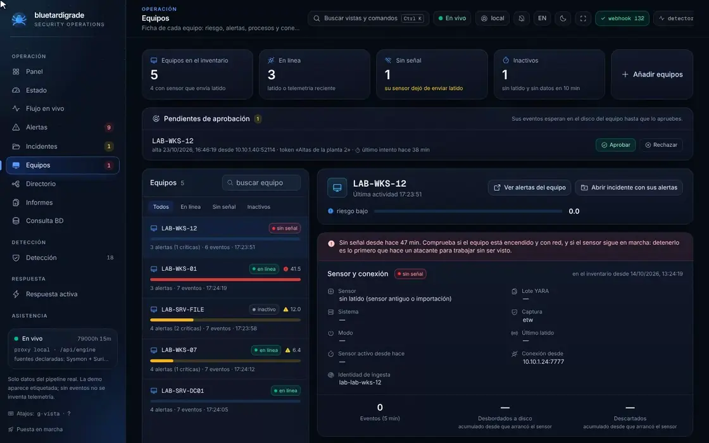

The fleet at a glance (online, silent, idle) from sensor heartbeats, guided
**enrollment** of new machines, and a page per host: risk, sensor health, the
**live process tree**, entity graph, timeline and network destinations.

### 5 · Engineer detections

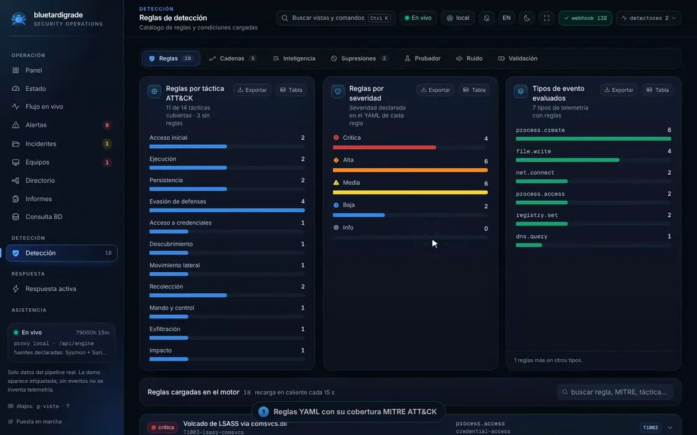

Rule coverage by **ATT&CK tactic**, severity and event type; **kill chains**
drawn as flows with per-step alerts; suppressions with a reason and an expiry;
and a **rule tester** that dry-runs an event against the live rules.

### 6 · Watch telemetry and platform health

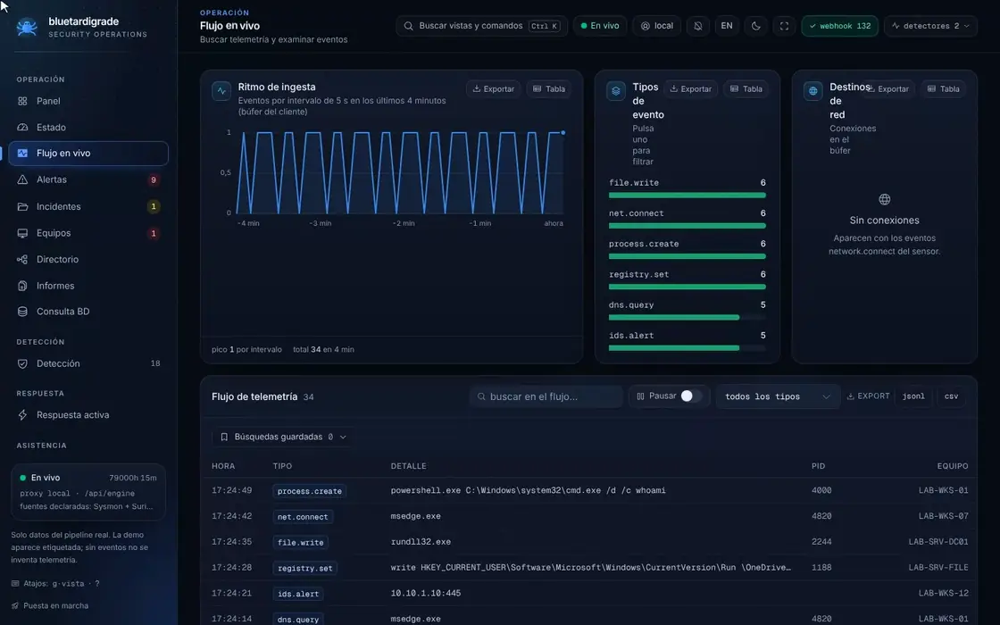

The live feed with pause, search, type filters and JSONL/CSV export, and the
health of every stage: engine, ingest, queues, store and external delivery.
Metrics the engine does not publish show `—`, never a fake zero.

### 7 · Respond, on your terms

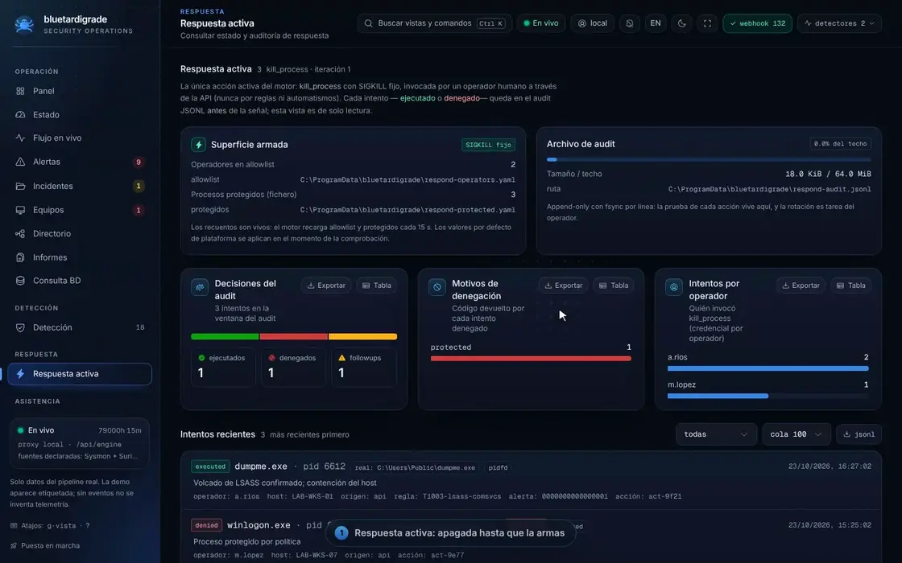

Active response is **off until you arm it**, needs per-operator credentials,
refuses protected processes, and every attempt — executed or denied — is
audited.

### 8 · Move fast: keyboard, themes and NOC mode

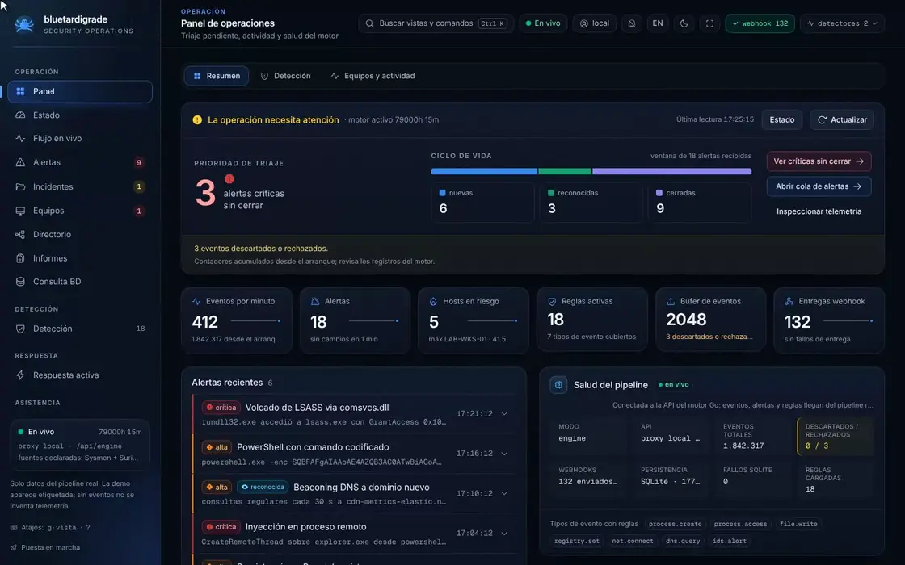

`Ctrl+K` reaches any view or action, `g` + a letter jumps between views, deep
links survive a refresh, and **NOC mode** turns a wall monitor into a rotating
situation board.

---

## Why bluetardigrade

<table>
<tr>
<td width="50%" valign="top">

**🧱 One binary, no runtime dependencies**<br/>
The engine is a static Go executable: ingest, detection, correlation, API,
SQLite history and delivery in one process.

</td>
<td width="50%" valign="top">

**📖 Detections you can read**<br/>
Every rule is YAML mapped to MITRE ATT&CK, hot-reloaded and testable from the
console. Sigma rules can be imported. Nothing is a black box.

</td>
</tr>
<tr>
<td width="50%" valign="top">

**🧾 From alert to evidence**<br/>
Every alert freezes a forensic bundle: the triggering event plus a
five-minute timeline of the host, with its process tree.

</td>
<td width="50%" valign="top">

**🔒 Safe by default**<br/>
Loopback-only listeners, authenticated ingest, append-only evidence, audited
access and active response that stays off until you arm it.

</td>
</tr>
</table>

## What you get

<table>
<tr>
<td width="50%" valign="top">

### 🎯 Detect
- **125 YAML rules** across 13 of the 14 ATT&CK tactics: initial access,
  LOLBAS, privilege escalation, credential access, lateral movement,
  collection, exfiltration, ransomware, hack tools, phishing and Active
  Directory attacks (DCSync, Kerberoasting, privileged groups).
- **13 kill-chain correlations**: 11 within a host, 2 that follow one account
  across machines.
- **YARA** in the sensor: written files, on demand and **process memory**,
  with a rule pack the engine distributes.
- Offline **threat-intel lists**, per-host **process baseline**, **C2
  beaconing**, volumetric **thresholds** and decaying **risk scores**.
- **Sigma import** and 17 rule operators.

</td>
<td width="50%" valign="top">

### 🔎 Investigate
- Live console with **13 views**, command palette, deep links and **ES/EN**.
- **Forensic bundles** with JSON/JSONL export.
- Paged **history** backed by SQLite, plus a read-only **SQL view** for
  administrators.
- Alert lifecycle, **assignment**, notes and saved searches.
- **Incidents** with graph, timeline and Markdown or printable reports.
- **Active Directory** directory and posture, read-only.
- Optional **AI analyst** with your own model.

</td>
</tr>
<tr>
<td width="50%" valign="top">

### ⚡ Respond
- Opt-in **`kill_process`**, armed per engine.
- Per-operator credentials: every action has an owner.
- Every request, executed or denied, in a forensic **audit log**.
- **Host groups** limit what each account sees and touches.

</td>
<td width="50%" valign="top">

### 🔌 Integrate
- **Webhooks**, **Elasticsearch**, **Splunk HEC**, **Slack**, **Telegram**
  and **email**.
- **REST + SSE** API with an OpenAPI contract checked in CI; **Prometheus**
  metrics.
- Imports **Suricata, Zeek, osquery, Cowrie**, Windows firewall logs,
  offline **EML** mail and DC Security logs over **WEF**.

</td>
</tr>
</table>

## Quickstart

> [!IMPORTANT]
> Use a **normal PowerShell** to install and run, and an **Administrator
> PowerShell** only when a step says so (kernel ETW tracing needs elevation).

**1. Install** (user-level, no admin):

```powershell
irm https://raw.githubusercontent.com/Ruby570bocadito/bluetardigrade/main/install.ps1 | iex
```

To build the Rust ETW sensor too, pass `-WithSensor`:

```powershell
& ([scriptblock]::Create((irm https://raw.githubusercontent.com/Ruby570bocadito/bluetardigrade/main/install.ps1))) -WithSensor
```

**2. Open a new terminal** so the `PATH` change applies, and check it:

```powershell
sf-engine version
```

**3. Install a sensor once**: the Rust ETW sensor with `sf-etw -Install` (one
UAC prompt), or Sysmon with `sf-sensor -SetupSysmon`.

**4. Start everything.** The browser opens at <http://localhost:3000>:

```powershell
sf-start      # engine, console, AI hub and the sensor service
sf-status     # what is running
sf-stop       # stops it all (-KeepSensor keeps the sensor capturing)
```

**5. Verify the pipeline and fire a harmless detection** (the download target
is a closed local port, so nothing is fetched):

```powershell
sf-engine doctor
certutil -urlcache -f http://127.0.0.1:9/prueba.txt "$env:TEMP\prueba.txt"
```

The console raises **"Descarga con certutil o bitsadmin"** (MITRE T1105)
within seconds.

<details>
<summary><b>All commands</b></summary>

| Command | What it does |
|---|---|
| `sf-start` | Starts everything: engine, console and the ETW sensor service |
| `sf-stop` | Stops everything (`-KeepSensor` keeps the sensor capturing) |
| `sf-status` | Shows what is running |
| `sf-engine` | The detection engine (`doctor`, `version`, `report`, `sigma`…) |
| `sf-console` | Engine + console without the sensor; manages console accounts |
| `sf-etw` | Installs and manages the ETW sensor service |
| `sf-sensor` | Sysmon sensor |
| `sf-collector` | Log and mail importer |
| `sf-update` | Updates the install |
| `sf-uninstall` | Removes it |

</details>

<details>
<summary><b>Pin a release, installer switches, Windows Server</b></summary>

The one-liner and `sf-update` track `main`. For a reproducible install, pin a
release tag in both the URL and `-Branch`:

```powershell
$tag = 'v1.0.0-rc1'   # a published release tag you reviewed
& ([scriptblock]::Create((irm "https://raw.githubusercontent.com/Ruby570bocadito/bluetardigrade/$tag/install.ps1"))) -Branch $tag
```

| Switch | What it does |
|---|---|
| `-WithSensor` | Also builds the Rust ETW sensor |
| `-AutoStart` | Starts the engine at logon |
| `-IngestToken <t>` | Sets the ingest authentication token |
| `-Server` | Installs boot tasks under ProgramData (admin) |

- The installer verifies every toolchain download by SHA-256.
- **Release provenance:** binaries carry a Sigstore build attestation
  (`gh attestation verify <file> --repo Ruby570bocadito/bluetardigrade`).
- **Windows Server** without an interactive session:
  [server deployment](docs/WINDOWS-SERVER.md).
- **Smart App Control blocks a binary:**
  [application-control diagnosis](docs/SMART-APP-CONTROL.md).

</details>

<details>
<summary><b>Linux, macOS or Docker (engine + collectors)</b></summary>

The source path needs **Go 1.26.10 or newer** (<https://go.dev/dl/>) and
**make**; Docker needs neither.

```bash
git clone https://github.com/Ruby570bocadito/bluetardigrade.git
cd bluetardigrade
make build
./bin/engine run -i                       # interactive terminal workspace
./bin/collector -source suricata -observer IDS-01 -file /path/to/eve.json
```

```bash
docker build -t bluetardigrade .
docker run --rm -p 127.0.0.1:7777:7777 -p 127.0.0.1:7778:7778 \
  -e SF_API_TOKEN -e SF_INGEST_TOKEN bluetardigrade
```

| Component | Default endpoint |
|---|---|
| Sensor ingest | `127.0.0.1:7777`: NDJSON over TCP, optional TLS + AUTH |
| Engine API | `http://127.0.0.1:7778`: REST, SSE and Prometheus |
| Web console | `http://localhost:3000` |
| AI analyst hub (optional) | `http://127.0.0.1:3003` |

</details>

## Telemetry sources

| Source | What it collects | Notes |
|---|---|---|
| **Rust ETW sensor** (`sensor/`) | Process creation (command line, parent, owner SID, image path and SHA-256), TCP connections with the resolved domain, DNS queries, registry writes the detections read (Run, IFEO, Defender, LSA, services…), YARA matches on files and process memory | Bounded queue plus an on-disk spool: an engine restart loses no events. Runs as a Windows service |
| **Sysmon** (`sf-sensor`) | Process, network, registry, file and image-load events | Ships a tuned config; `sf-sensor -SetupSysmon` installs it |
| **Collector** (`sf-collector`) | Suricata EVE, Zeek conn, osquery differential, Cowrie, Windows firewall logs, EML mail | Offline import; never runs provider commands or visits mail URLs |
| **Windows Event Forwarding** | Security and System logs of domain controllers and servers | Nothing installed on the DCs: [subscription guide](docs/AD-WEF-SUSCRIPCION.md) |

## Console tour

A Next.js console. Everything reaches the engine through its same-origin
proxy, so the API token never reaches the browser.

<table>
<tr>
<td width="50%">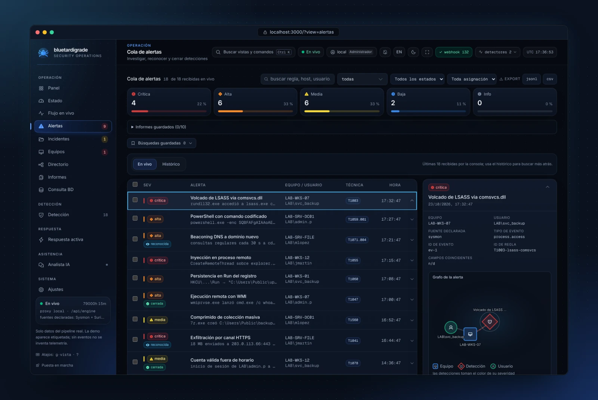</td>
<td width="50%">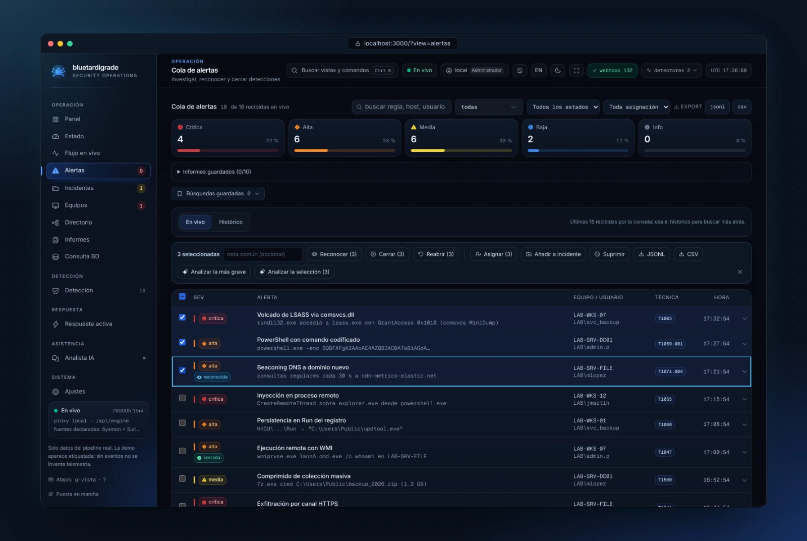</td>
</tr>
<tr>
<td><b>Alertas</b> · live queue or paged history; detail with graph, forensic bundle, reputation and reports</td>
<td><b>Bulk actions</b> · triage, assign, suppress or open an incident for a whole selection</td>
</tr>
<tr>
<td>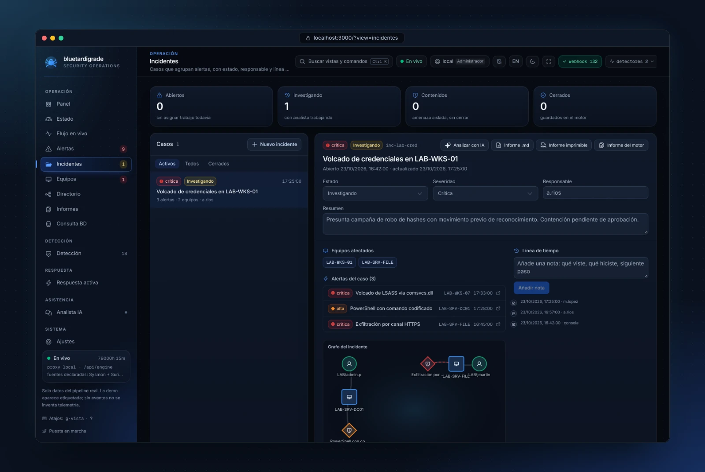</td>
<td>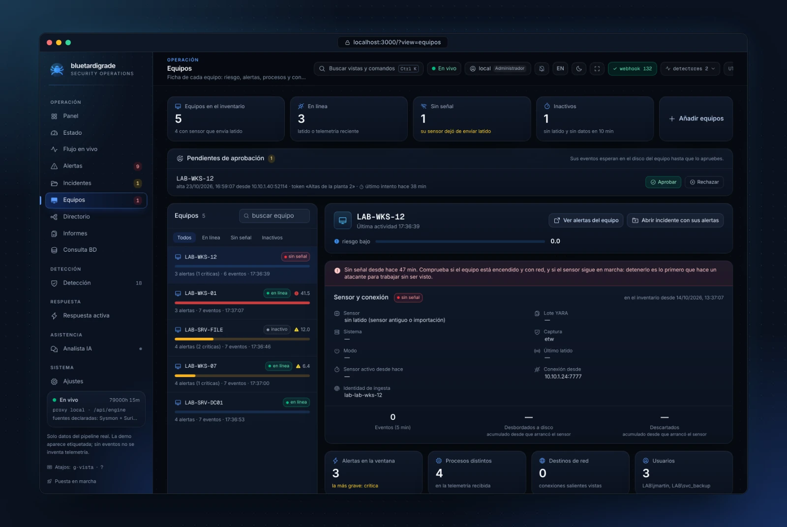</td>
</tr>
<tr>
<td><b>Incidentes</b> · cases with owner, affected hosts, graph and timeline</td>
<td><b>Equipos</b> · fleet status, enrollment and a page per host</td>
</tr>
<tr>
<td>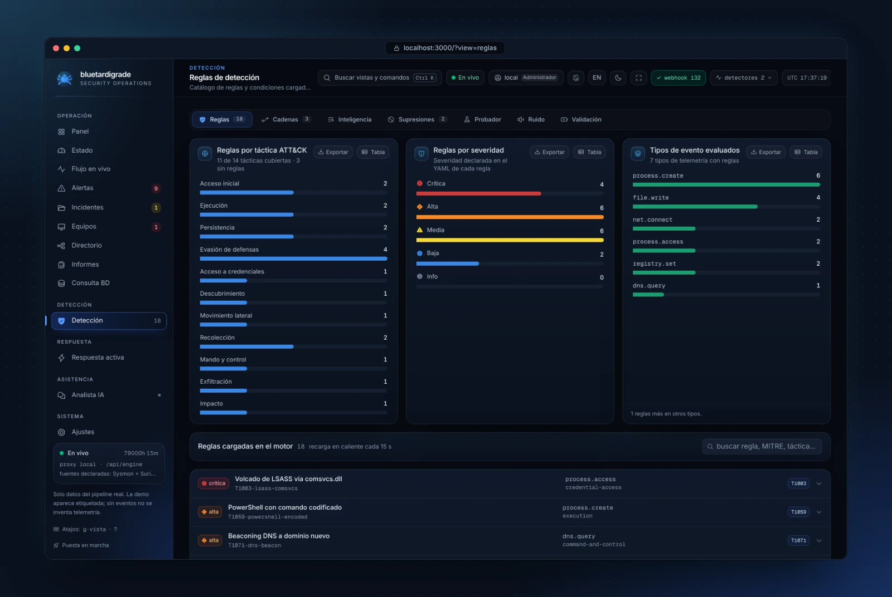</td>
<td>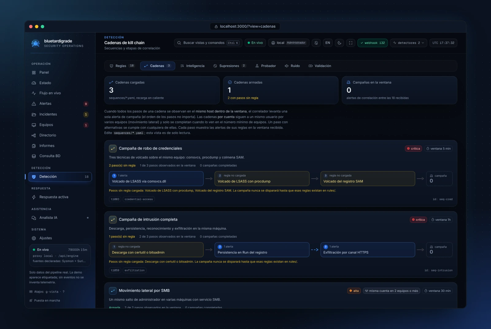</td>
</tr>
<tr>
<td><b>Detección</b> · ATT&CK, severity and event-type coverage of the loaded rules</td>
<td><b>Cadenas</b> · kill chains step by step, with completed campaigns</td>
</tr>
<tr>
<td>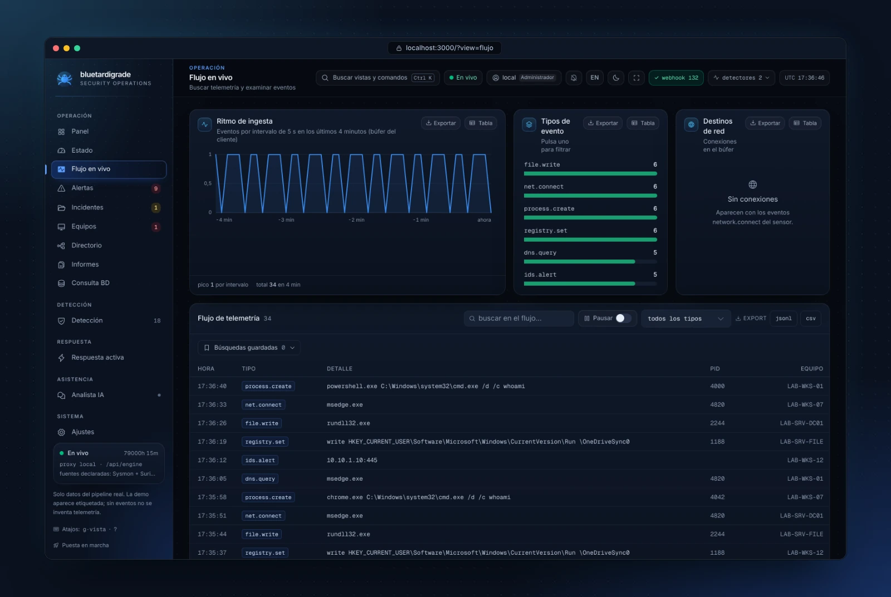</td>
<td>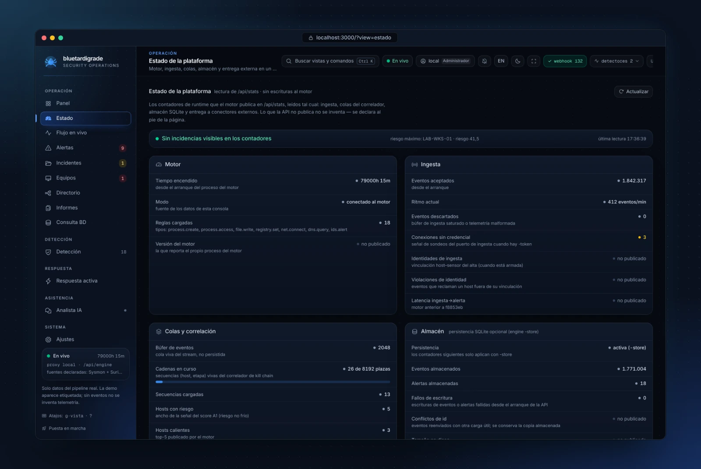</td>
</tr>
<tr>
<td><b>Flujo en vivo</b> · the raw telemetry, filterable and exportable</td>
<td><b>Estado</b> · runtime counters of every stage of the pipeline</td>
</tr>
<tr>
<td>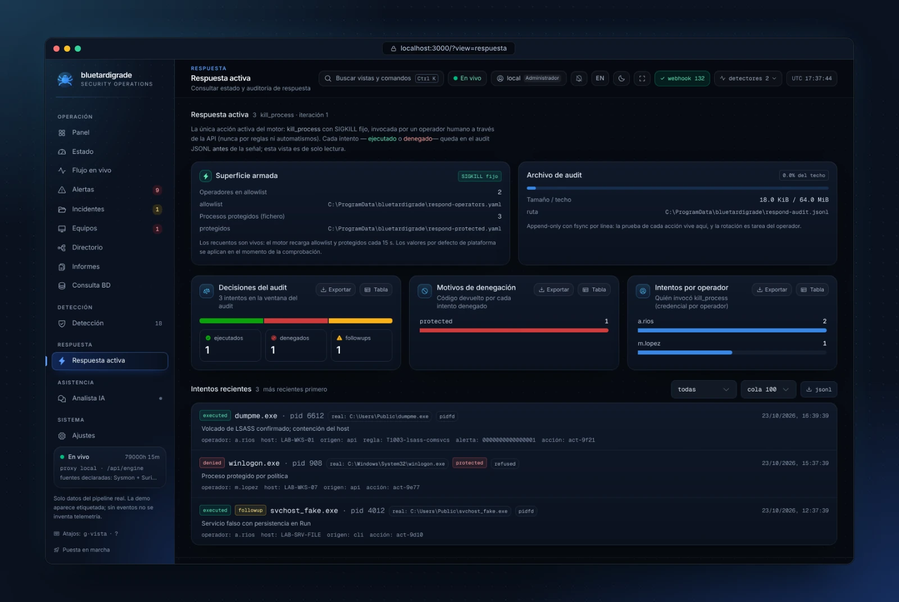</td>
<td>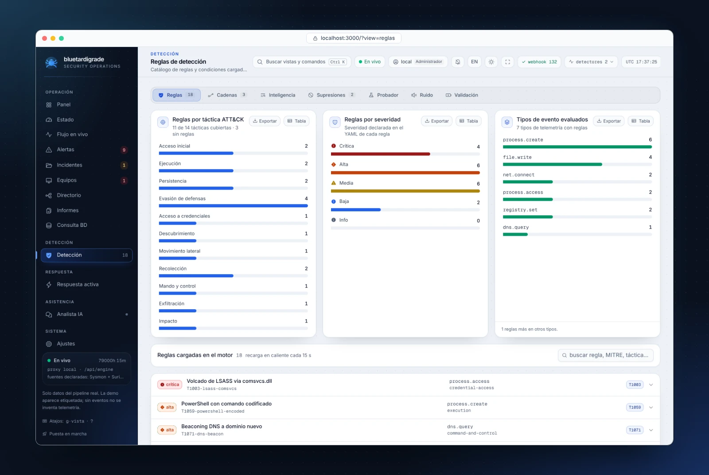</td>
</tr>
<tr>
<td><b>Respuesta activa</b> · arming state, decisions and denial codes</td>
<td><b>Light theme</b> · every view, validated for contrast in both themes</td>
</tr>
</table>

<details>
<summary><b>Every view</b></summary>

| View | What the analyst does there |
|---|---|
| **Panel** | Triage backlog, KPIs, activity and severity trends, investigation graph, MITRE coverage and a host × tactic heatmap |
| **Estado** | Platform health: engine runtime counters, ingest, queues, store and external delivery |
| **Flujo en vivo** | Live telemetry with pause, search, type filters and JSONL/CSV export |
| **Alertas** | Live queue or paged history; bulk triage, assignment, incidents, suppressions and exports; per-alert graph, forensic bundle, reputation, containment and reports |
| **Incidentes** | Cases that group alerts: status, severity, owner, hosts, graph and timeline |
| **Equipos** | Fleet status from heartbeats, enrollment and approval of new machines, host groups, and a page per host |
| **Directorio** | Read-only Active Directory snapshot and domain posture: findings, sensor coverage and objects |
| **Informes** | The engine's report catalogue with CSV/JSON download and a printable view |
| **Consulta BD** | Read-only SQL over the evidence store, administrators only, every query audited |
| **Detección** | Rules, kill chains, threat intel, suppressions, rule tester, noise report and detection validation |
| **Respuesta activa** | Arming state and the forensic response audit |
| **Analista IA** | Optional triage assistant with your own model |
| **Ajustes** | Language, accounts, host groups, the AD connector and integrations |

</details>

There is also a keyboard-driven **terminal workspace**: `engine run -i` (see
the [operations guide](docs/OPERATIONS.md)). To run the console from source:
[web/console/README.md](web/console/README.md).

## Security model

| Layer | Control |
|---|---|
| Ingest | Shared token or **per-sensor identities** bound to their hosts; events for other hosts are refused and counted |
| Transport | Native TLS on both listeners; the sensor trusts only the CA you give it |
| API | Bearer token; listens on loopback by default |
| Console | Sign-in page and expiring sessions; **per-analyst accounts** (viewer / analyst / admin) or **Active Directory accounts** by group; optional or per-role **TOTP**; **host groups** that limit what an account sees; every write and sign-in audited |
| AI hub | `HUB_ACCESS_TOKEN` per socket, Origin allowlist and shared rate limits |
| Response | `kill_process` needs an arm flag, a response token and **per-operator credentials**; protected processes are refused; every attempt audited |
| Evidence | Stored events are **append-only**: a second copy of an event id cannot rewrite the first |
| Privacy | Reads of a user's directory record are audited; personal audit tables expire with the store retention |
| Supply chain | SHA-pinned GitHub Actions, minimal permissions, Sigstore release attestations |

Report vulnerabilities privately: [SECURITY.md](SECURITY.md).

## Architecture

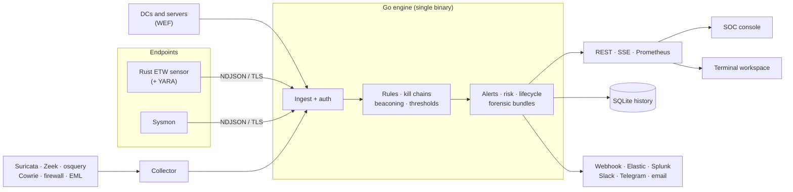

`pkg/model` defines the event contract every sensor emits. Package
responsibilities and data flow: [ARCHITECTURE.md](docs/ARCHITECTURE.md).

**Performance**, from loopback lab measurements (not deployment guarantees):

| Measurement | Before | Now |
|---|---|---|
| Throughput with `-store` (SQLite on), using batched transactions | ~8.3k events/s | **~23.6k events/s** |
| Rule field resolution | 8.0 µs per event | **1.7 µs per event** |

Ingest→alert p99 latency was about 0.4 ms. Reproduce it with
`scripts/dev-tests/bench`, following the
[method](docs/OPERATIONS.md#measured-performance).

<details>
<summary><b>Repository layout</b></summary>

```text
cmd/engine/          Go engine, interactive CLI, doctor, reports
cmd/collector/       observed-log and offline mail importer
internal/            detection, correlation, store, API, delivery, response
pkg/model/           event wire contract
sensor/              Rust Windows ETW sensor (+ YARA)
rules/  sequences/   YAML detection content and kill chains
web/console/         Next.js SOC console
web/console-service/ Bun + socket.io AI analyst hub
website/             project landing page
scripts/             Windows tooling, dev tests and verification harnesses
tools/               browser-test tooling for the console
changelog.d/         one changelog fragment per change, consolidated on release
docs/                guides, architecture, API reference and README media
```

</details>

## Documentation

| Document | Use it for |
|---|---|
| [Guía de inicio](docs/GUIA-INICIO.md) | First run, operation and troubleshooting (Spanish) |
| [Operations](docs/OPERATIONS.md) | Flags, environment, API, storage, integrations, accounts, response, CLI |
| [Architecture](docs/ARCHITECTURE.md) | System design, event contract, feature inventory |
| [Remote fleet](docs/FLOTA-REMOTA.md) | Enrolling remote machines: identities, TLS, firewall, silent-sensor alerts (Spanish) |
| [AD over WEF](docs/AD-WEF-SUSCRIPCION.md) | Forwarding DC and server logs without installing anything on them (Spanish) |
| [Deployment doctor](docs/DOCTOR.md) | Diagnosing rules, tokens, TLS, SQLite, sensors and console |
| [False-positive control](docs/false-positive-control.md) | Dedup, suppressions and noise tuning |
| [File detections and evidence](docs/DETECCION-Y-EVIDENCIA.md) | Artifact alarms and forensic evidence |
| [SOC integrations and reports](docs/SOC-INTEGRACIONES-E-INFORMES.md) | Collector formats, investigation workflow, reports |
| [Email phishing](docs/PHISHING.md) | Explainable indicators in imported EML |
| [Windows Server](docs/WINDOWS-SERVER.md) | Boot tasks and persisted credentials |
| [Startup fixes](docs/STARTUP-FIXES.md) | Windows startup: hub origin, console CSP, inherited credentials |
| [Smart App Control](docs/SMART-APP-CONTROL.md) | Execution blocks and signing |
| [Threat model](docs/MODELO-DE-AMENAZAS.md) | What the platform defends against, and how (Spanish) |
| [Pending tests](docs/PRUEBAS-PENDIENTES.md) | What still needs a real Windows host (Spanish) |
| [OpenAPI](docs/api/openapi.yaml) | API integration |
| [Roadmap](docs/ROADMAP.md) · [Changelog](CHANGELOG.md) | What's next, and what shipped |

## Development

```bash
make test        # Go tests
make ci          # everything CI runs (prerequisites in the Makefile)

cd web/console && bun test && bun run typecheck && bun run build
make console-browser   # Chromium checks of the built console, desktop + mobile
make console-a11y      # axe (WCAG 2.1 AA) over every view, both themes
```

CI runs Go formatting, vet, staticcheck and race tests; console and hub tests,
type checks and a production build; DOM, Chromium, accessibility, CSP and
motion checks of the console; the OpenAPI drift guard; Rust checks on Linux and
Windows; and a native Windows response smoke test — on SHA-pinned actions with
minimal permissions. Releases are gated on SemVer and the changelog.

<details>
<summary><b>Regenerating the README media</b></summary>

Screenshots, framed images and demo clips are all scripted from the console
build and the repository's fixtures (details in
[docs/assets/README.md](docs/assets/README.md)):

```bash
node docs/assets/src/capture_console.mjs   # console-*.png
node docs/assets/src/frame_shots.mjs       # showcase/*.webp
node docs/assets/src/record_demo.mjs       # demo/raw/*.webm
docs/assets/src/make_media.sh              # demo/*.webp + the MP4 tour
```

</details>

## Roadmap

- **Before 1.0:** a 24–48 h soak test with the sensor as a service, laptop
  suspend, long engine outages and a week of CPU and memory on real Windows
  hosts ([checklist](docs/PRUEBAS-PENDIENTES.md)).
- **Next:**
  - extended response, opt-in at install: isolate a host, quarantine a file,
    signed and audited orders to the sensor, one- or two-person approval;
  - notifications configured from the console, self-hosted push (ntfy) and a
    phone view;
  - a reviewed SigmaHQ pack, a rule editor and YARA management in the console;
  - continuous anti-phishing (IMAP mailbox, SPF/DKIM/DMARC, look-alike domains,
    QR codes).
- **Later:** `lite` and `full` editions, a signed plugin catalogue, explainable
  ML triage, and many engines under one master for large fleets.

The full plan is in [docs/ROADMAP.md](docs/ROADMAP.md) and [TODO.md](TODO.md).

## Contributing

Open an issue, or a focused PR that states the problem, the resulting behavior
and how you verified it. Detection changes should include the modeled TTP, lab
events that trigger it and the observed false-positive profile.

> The project was renamed from `security-framework`. GitHub redirects the old
> URLs, and the Windows shims keep their `sf-*` names so existing installs
> keep updating.

## License

[Apache License 2.0](LICENSE)
